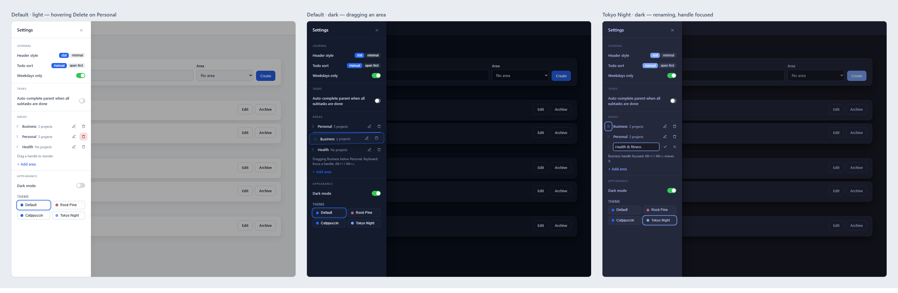
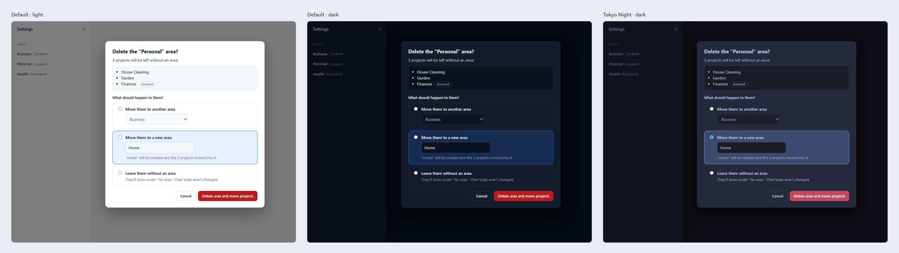
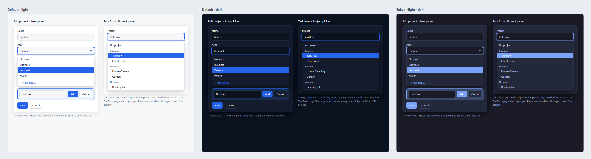

# Areas mockups (#490, #585)

These are the owner-approved mockups for the Areas web UI. They were approved on 2026-11-24.
The issue's acceptance criteria are the source of truth. These files show the intended look.

- Story: https://github.com/nevridge/TaskFlow/issues/585
- API and assistant half: https://github.com/nevridge/TaskFlow/issues/490
- Design decision: https://github.com/nevridge/TaskFlow/issues/491#issuecomment-7148692499

## Files

Each artboard shows the same screen three times, side by side: Default light, Default dark and Tokyo Night dark.

| File | Shows | #585 ACs |
|---|---|---|
| `Main.dc.html` | The settings drawer's new **Areas** section, with the Projects page grouped by area behind it. Each theme shows one state: hovering Delete (light), dragging an area with a drop line (dark), and renaming an area while a handle has keyboard focus (Tokyo Night). | 1 to 9, 14 |
| `DeleteDialog.dc.html` | The delete dialog shown above the dimmed drawer, with "Move them to a new area" selected. | 10 to 13 |
| `Pickers.dc.html` | The project form's Area select with "+ New area…" and its inline field, and the task form's project picker grouped by area. | 15 to 17 |
| `canvas.json` | Where each artboard sits on the design canvas. | - |
| `_runtime/` | The renderer that displays the pages in a browser. It is not part of the design. | - |

## Screenshots

Each PNG is a rendered copy of the artboard with the same name. These are the quickest way to see the design.

- `Main.png`: the settings drawer's Areas section.
  - The drawer covers the left side of the Projects page, as it does in the app, so the page's headings and project names are hidden behind it.
- `DeleteDialog.png`: the delete dialog shown above the drawer.
- `Pickers.png`: the Area select with "+ New area…", and the grouped project picker.

## Reading them

- **As source:** each `.dc.html` is plain HTML. Its colours are CSS variables copied from `TaskFlow.Web/src/index.css`.
  - The `.t-light`, `.t-dark` and `.t-tokyo` classes in the `<style>` block hold those token values.
  - The real implementation uses the app's existing tokens and classes (`.settings-section`, `.settings-row` and the others). It does not use these mockup classes.
- **In a browser:** run `python -m http.server` in this folder, then open a `.dc.html` file through it.
  - Opening the file directly may not work, because browsers can block its scripts.
  - The pages are static, so the buttons do nothing.

## Not to copy literally

- The sample area and project names are invented.
- The project counts are invented.
- The mockup's internal class names are invented.
- The canvas title on `Main.dc.html` mentions a "⋯ menu". That menu was replaced by the pencil and trash buttons before approval, and the artboard itself shows the approved buttons.
