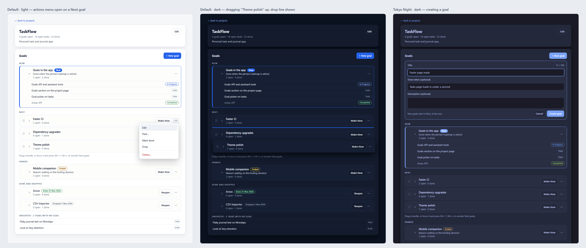
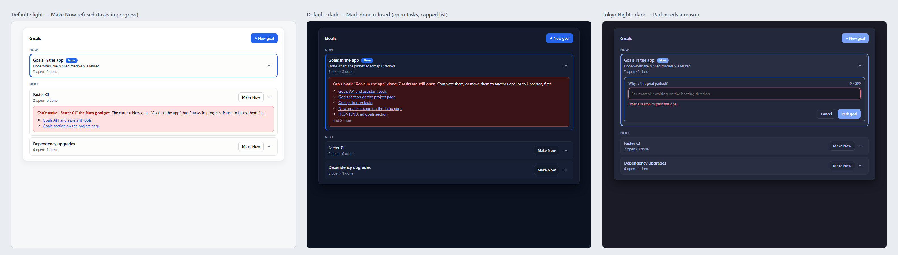
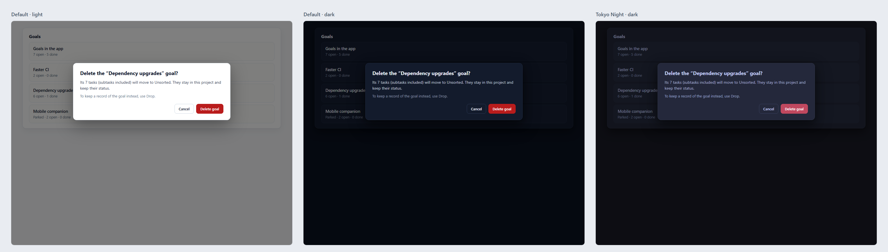

# Goals mockups (#583)

These are the owner-approved mockups for the goals section on the project page. They were approved on 2026-11-25.
The issue's acceptance criteria are the source of truth. These files show the intended look.

- Story: https://github.com/nevridge/TaskFlow/issues/583
- API and assistant half: https://github.com/nevridge/TaskFlow/issues/491
- Goal picker and Now-goal messages (not drawn here): https://github.com/nevridge/TaskFlow/issues/604
- Design decision: https://github.com/nevridge/TaskFlow/issues/491#issuecomment-7148692499

## Files

Each artboard shows the same screen three times, side by side: Default light, Default dark and Tokyo Night dark.

| File | Shows | #583 ACs |
|---|---|---|
| `Main.dc.html` | The project page with the new **Goals** panel between the project header and the task list: Now (expanded, with its tasks), Next (drag handles), Parked (with reason), Done and dropped (with dates and Reopen), then Unsorted. Each theme shows one state: the goal actions menu open (light), dragging a Next goal with a drop line (dark), and the new goal form (Tokyo Night). | 1 to 9, 11 to 13, 15 to 17 |
| `Refusals.dc.html` | Inline refusals under the goal they are about: Make Now refused because the Now goal has tasks in progress (light), Mark done refused with a capped list of open tasks (dark), and the Park form's required reason (Tokyo Night). | 7, 10, 14 |
| `DeleteDialog.dc.html` | The delete confirmation for a goal with tasks. | 18 to 20 |

## Screenshots

Each PNG is a rendered copy of the artboard with the same name.

- `Main.png`: the goals section. In the Tokyo Night copy the open form pushes the Done and Unsorted groups below the frame.
- `Refusals.png`: the three inline states.
- `DeleteDialog.png`: the delete dialog over the dimmed page.

## Design decisions shown

- **Actions:** Make Now (Next and Parked goals) and Reopen (Done and Dropped goals) are visible buttons. Edit, Park, Mark done, Drop and Delete sit in a ⋯ actions menu on each goal row. The app has no menu component yet, so the build adds one (keyboard: arrow keys move, Enter picks, Escape closes and returns focus to the ⋯ button).
- **Unsorted** is the last group inside the Goals panel. The existing Tasks panel below stays unchanged.
- **Done and dropped** is listed open, not collapsed.
- **Counters:** the title counter uses the task title limit (100). Tasks have no description limit, so description and "done when" show no counter unless #491 adds a limit. The parked reason counter assumes 200, like a blocked reason; use whatever #491 ships.
- **Refusal lists** link each task to its task page and show at most five, then "and N more".
- **Delete** of a goal with no tasks needs no dialog (AC 19), so it is not drawn.

## Reading them

- **As source:** each `.dc.html` is plain HTML. Its colours are CSS variables copied from `TaskFlow.Web/src/index.css`.
  - The `.t-light`, `.t-dark` and `.t-tokyo` classes in the `<style>` block hold those token values.
  - The real implementation uses the app's existing tokens and classes (`.projects-page .p-*` and the others). It does not use these mockup classes.
  - The `{{ ... }}` holes and the `<sc-for>` / `<sc-if>` tags are the design tool's templating. They repeat each screen once per theme and switch the state each copy shows.
- **In a browser:** the renderer the design tool needs is not committed, so use the screenshots. The live canvas is linked from #583 (owner-only).

## Not to copy literally

- The sample goal, task and project names are invented.
- The counts and dates are invented.
- The mockup's internal class names are invented.
